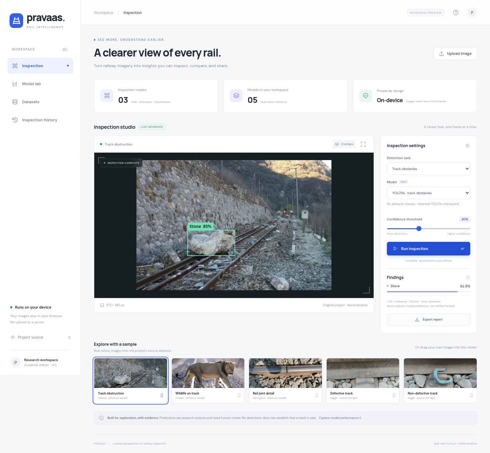

# Pravaas — Rail Intelligence

A rebuilt railway inspection workspace with **real browser inference**, source-traceable models, and a reproducible CNN/transfer-learning lab. No inference server or API key is required for the UI. Uploaded images remain in the browser.

## Run the application

```bash
git clone --branch codex/pravaas-rebuild https://github.com/KirtirajChaudhari/Pravaas.git
cd Pravaas
python3 -m http.server 4173 --directory dist
# Open http://localhost:4173
```

The committed `dist/` directory includes models, ONNX Runtime Web, sample images, and measured experiments. Serve over HTTP; opening `index.html` as a `file://` URL does not support model loading. The first inference downloads the selected model and the WASM runtime. A desktop Chromium-based browser is recommended; large images are limited to 20 MB and 40 megapixels.

For development and checks:

```bash
npm ci
npm test
npm run check
npm run build
npm run dev
```



## What works

- Image upload and drag-and-drop; real dataset samples.
- Rail-region localization and six-class obstacle detection with class-aware NMS.
- Defective/non-defective classification using three newly trained models.
- Confidence thresholds, switchable bounding-box overlays, expanded image view.
- Per-image JSON reports and browser-local history with CSV export.
- Model comparison, confusion matrices, validation curves, training time, parameter counts, and dataset provenance.
- Responsive, keyboard-accessible interface and visible inference failures; no simulated predictions or invented metrics.

### Important model distinctions

| Model | Actual task | Origin |
| --- | --- | --- |
| Small CNN | Defective / Non-defective | Random initialization; trained for this rebuild |
| MobileNetV3 Small, frozen | Defective / Non-defective | ImageNet backbone; new classification head trained here |
| MobileNetV3 Small, fine-tuned | Defective / Non-defective | Selected frozen model, then last three feature blocks fine-tuned |
| YOLOv8n reference | **Railway region localization** | Inherited from Rail-defect-detection |
| YOLO11s reference | Animal, Debris, Human, Object, Stone, Tree | Inherited from original Pravaas |

The first reference repository's name suggests fault detection, but its checkpoint exposes only the label `railway`. Its boxes must not be described as localized cracks. The original Pravaas checkpoint has six classes; a later dataset archive containing a seventh `vehicle` class does not change the checkpoint. Classification predicts an image-level label; it does not generate defect boxes.

## Reproduce the classification lab

The runnable [Lab 4 notebook](notebooks/Lab_4_Pravaas.ipynb) walks through architecture, training, confusion matrices, and learning curves.

Python 3.12 was used. CPU training is supported. To avoid downloading a CUDA distribution on a CPU machine, install CPU PyTorch first.

```bash
python3 -m venv .venv
source .venv/bin/activate
pip install torch torchvision --index-url https://download.pytorch.org/whl/cpu
pip install -r requirements.txt
python ml/download.py --output data/kaggle.zip
python ml/prepare.py data/kaggle.zip --output data/classification
python ml/train.py --data data/classification --output artifacts \
  --epochs 12 --finetune-epochs 5 --threads 2
python ml/publish_artifacts.py --artifacts artifacts --data data/classification
```

Preparation preserves the source dataset's train/validation/test split where available and removes exact decoded-image duplicates across partitions with priority test → validation → train. If all three source splits are not present, it performs a seeded stratified 70/15/15 split. Every retained image has a source path, label, split, and pixel SHA-256 in `dist/data/manifest.json`.

All classification models use 128×128 RGB input and ImageNet normalization. Training uses horizontal flips and mild brightness augmentation. The ONNX graph includes normalization and softmax; the browser supplies RGB floats in [0, 1]. Frozen feature blocks remain in evaluation mode, preserving their BatchNorm statistics. AdamW and cross-entropy are used. The checkpoint is selected by validation loss; the test split is evaluated only after checkpoint selection.

`dist/data/experiments.json` contains actual measurements, epoch histories, configuration, and confusion matrices. **Defective is the positive class** for precision, recall, and F1. Fine-tuning time is the incremental stage, excluding earlier feature-extraction training. Batched Python evaluation latency and single-image browser latency are not directly comparable.

Exact deduplication does not remove near-duplicates or shared capture sessions. The dataset is small; source-group splits and evaluation across independent routes/cameras are required before drawing deployment conclusions. A high test accuracy on this dataset is not a railway safety guarantee.

## Detectors and Roboflow

The requested Roboflow URL is a search page, not a pinned dataset release. Direct Universe access returned HTTP 403 during the rebuild. The reference GitHub repository includes YOLO annotations and Roboflow-marked filenames; its README links to `defect-rexb3/rail-defect`. These files and inherited weights are used for the demonstration, with their provenance limitations recorded. No fresh Roboflow export or newly trained Roboflow detector is claimed.

To train on a chosen, licensed YOLO export with explicit train/val/test partitions:

```bash
python ml/train_detector.py --data path/to/data.yaml \
  --model yolo11n.pt --epochs 50 --device 0
# For randomly initialized weights, add --scratch.
```

The selected checkpoint is evaluated on the export's test split and writes real metrics. Check capture-group leakage and class meanings before training. Inherited detector mAP is deliberately not shown as a verified result because the original training/test membership is unknown.

To reproduce the deployed detector exports:

```bash
python ml/export_detectors.py \
  --rail /path/to/Rail-defect-detection/best.pt \
  --obstacles /path/to/original-Pravaas/best.pt
```

The YOLO models use 416×416 letterboxed input. The browser reverses the padding and scale, clips to image bounds, and performs class-aware NMS at IoU 0.45. Large ONNX weights are stored as external chunks below the static hosting per-file limit. Model downloads and initialization are excluded from displayed inference latency.

## Structure

```text
dist/                 Self-contained static application
  app.js              UI, image workflow, reports and history
  inference.js        ONNX inference, letterboxing, box decoding, NMS
  data/               Model registry, provenance and measured experiments
  models/             Deployable ONNX graphs and external weights
  samples/            Attributed demonstration images
  vendor/             Pinned ONNX Runtime Web assets
ml/                   Preparation, training, evaluation and export scripts
tests/                Geometry tests and browser integration checks
docs/                 Lab mapping, model card and source audit
artifacts/            Experiment report (large training checkpoints ignored)
```

The original notebooks and archives are preserved when this rebuild is added to the original repository. They are historical reference material, not the current execution path.

## Deployment and privacy

Deploy `dist/` on any static host. `vercel.json` configures a static Vercel deployment. The private Sites deployment is a separate showcase. No external inference endpoint, secrets, sign-in flow, or database is needed. Reports are stored only in the browser's local storage (up to 100); clearing browser data removes them. Uploaded image pixels are never stored in history. JSON reports include filenames and model outputs, so review them before sharing.

Research use only: predictions require human review. A low score or no detection does not establish that a track is safe. There is no out-of-distribution rejection, calibrated risk score, operational alerting, or certification.

See [source attribution](docs/SOURCES.md), [model card](docs/MODEL_CARD.md), [Lab 4 mapping](docs/LAB_4.md), and [verification report](docs/VERIFICATION.md). Dependencies, weights, and sample images retain their original licenses; see [third-party notices](THIRD_PARTY_NOTICES.md).
